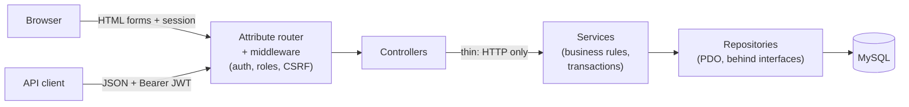
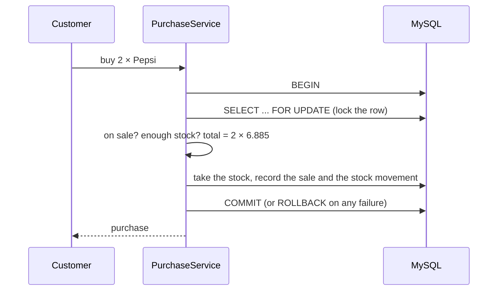

<div align="center">

# Vending Machine

**A complete vending machine system in plain PHP 8.4: no framework, just PDO, MySQL and clean architecture.**

[](https://github.com/KSHDestiny/vending-machine-php/actions/workflows/ci.yml)


**[Live demo](https://web-production-d5f8dfd1.up.railway.app/login)** ·
**[API docs (Swagger)](https://web-production-d5f8dfd1.up.railway.app/docs)** ·
[Run locally](#run-locally) ·
[API](#rest-api) ·
[Tests](#tests-and-ci)

</div>

---

Admins manage products, stock and users; customers buy products and see their purchase
history. Every purchase is a single locked database transaction, so stock can never be
oversold, and prices are exact decimals (Pepsi stays **$6.885**). The same rules are
available as a JWT-secured REST API with interactive docs.

> **Try it:** register a customer account on the [live demo](https://web-production-d5f8dfd1.up.railway.app/register)
> and buy something. Admin credentials for reviewers are sent separately.

## Screenshots

| Admin dashboard | Storefront |
| --- | --- |
|  |  |
| **Stock history** | **User management** |
|  |  |
| **Transactions: filters and CSV export** | **Interactive API docs** |
|  |  |

<p align="center"> &nbsp; <br><sub>Works on phones: the sidebar becomes a menu and wide tables become cards.</sub></p>

## Contents

- [Features](#features)
- [Tech stack](#tech-stack)
- [Architecture](#architecture)
- [Database design](#database-design)
- [Run locally](#run-locally)
- [Web pages](#web-pages)
- [REST API](#rest-api)
- [Tests and CI](#tests-and-ci)
- [Deployment (Railway)](#deployment-railway)
- [Known limitations](#known-limitations)

## Features

### Shopping

| Feature | How it works |
| --- | --- |
| **Exact prices** | `DECIMAL(10,3)` and BCMath: Coke `3.99`, Pepsi `6.885` and Water `0.5` are seeded and never rounded. |
| **Safe purchases** | One transaction locks the product row (`SELECT ... FOR UPDATE`), checks stock, takes it, and records the sale at the database price. Six buyers racing for the last item produce exactly one sale (tested). |
| **Product list** | Search, sort by name, price or stock, 10 per page. |
| **Purchase history** | Each purchase keeps the product name and price it was bought at, so renames and price changes never rewrite history. |

### Administration

| Feature | How it works |
| --- | --- |
| **Products** | Add, edit and delete (soft delete), and take products off sale without deleting them. |
| **Stock history** | Every change is recorded: initial stock, restock, purchase, adjustment, with before and after, who made it, and why. |
| **Dashboard** | Revenue, purchases, low-stock warnings with one-click restock, and a 7/14/30-day sales trend chart (SVG, no JavaScript library). |
| **Transactions** | Filter by customer, product and date range, with exact totals and a CSV export of the filtered list. |
| **Users** | Search and filter, change roles, deactivate (signs the user out everywhere). The primary admin and the last active admin are protected, even when two admins act at once. |

### Security

| Feature | How it works |
| --- | --- |
| **Access control** | Session login for the web and JWT for the API; Admin and Customer roles checked on the server for every request. |
| **Input and output** | Server-side validation mirrored in the browser, CSRF tokens, escaped HTML, prepared statements. |
| **Sessions** | Stored in MySQL as SHA-256 hashes; they end after 2 h idle or 12 h; HttpOnly, SameSite, Secure in production. |
| **Headers** | Content-Security-Policy (only the site's own scripts), HSTS, Permissions-Policy, frame and sniffing protection. |
| **Login cooldown** | Five wrong passwords in a row pause logins from that session for 30 seconds, with a live countdown. |
| **No resubmits** | Every form redirects after it is sent (post, then redirect), so reloading never resends a form, a purchase or a password. |

## Tech stack

| Layer | Technology |
| --- | --- |
| Language | PHP 8.4 (`strict_types`), Composer PSR-4 autoloading |
| Database | MySQL 8.4 through PDO, plain SQL migrations |
| Web server | Apache in Docker, single front controller (`public/index.php`) |
| Routing | PHP 8 attributes, e.g. `#[Route('/products/{id}/purchase', ['POST'], ['user'])]` |
| UI | Server-rendered PHP templates, Tailwind CSS (standalone build), a little vanilla JS |
| API | JSON with JWT (`firebase/php-jwt`), OpenAPI 3 document and Swagger UI |
| Quality | PHPUnit 13, PHPStan level 8, GitHub Actions |
| Hosting | Railway (web + private MySQL), deployed only after CI passes |

## Architecture



- **Controllers** only handle HTTP. Web and API controllers share the same **services**, so a rule (like "admins can't buy") exists once.
- **Services** hold the business rules and own the database transactions.
- **Repositories** are the only code that talks SQL; unit tests replace them with mocks.
- Everything is wired by constructor injection in `bootstrap/app.php`; there is no container or global state.

How a purchase stays safe:



```text
app/
  Controllers/        Web controllers and Api/ JSON controllers
  Services/           Business rules: purchase, products, inventory, users, auth, dashboard
  Repositories/       PDO queries behind interfaces
  Models/ Enums/      Product, User, Transaction, InventoryMovement, roles and statuses
  Auth/               Session and token sign-in, login cooldown
  Http/ Middleware/   Request/response, attribute router, sessions, CSRF, OpenAPI document
  Database/           PDO connection, transactions, query builder, migrator
bootstrap/app.php     Wires every object by constructor injection
resources/views/      PHP templates
public/index.php      The only public entry point
tests/                Unit/ (mocks, no database) and Integration/ (real MySQL)
```

## Database design

| Table | Columns | Notes |
| --- | --- | --- |
| `users` | id, name, email (unique), password (hash), role (`admin`/`user`), status (`active`/`inactive`), deactivated_at, timestamps | Plain passwords are never stored. Deactivated accounts keep their purchases. |
| `products` | id, name, price `DECIMAL(10,3)`, quantity_available (unsigned), status (`active`/`inactive`), timestamps, deleted_at | Deleting a product is a soft delete, so purchase history keeps it. |
| `transactions` | id, user_id → users, product_id → products, product_name, quantity, unit_price, total_price, created_at | Stores the product name and price at purchase time, so renames and price changes don't rewrite history. Foreign keys restrict deletes; a check keeps `total_price = unit_price × quantity`. |
| `inventory_movements` | id, product_id, user_id, transaction_id, movement_type, quantity_change, quantity_before, quantity_after, reason, created_at | Append-only stock history; a CHECK keeps before + change = after. |
| `sessions` | id (SHA-256 of the session ID), user_id → users, payload, last_activity, created_at | Web sessions; deleted with the user's account by cascade. |

Migrations are in `database/migrations/` and seeders in `database/seeders/`.

## Run locally

Requires Docker with Compose.

```sh
cp .env.example .env            # then replace every placeholder value
docker compose up -d --build
docker compose exec app composer migrate
docker compose exec app composer seed
```

Open <http://localhost:10000>.

- `composer seed` adds the three products and `admin@example.com` with the password from
  `DEMO_ADMIN_PASSWORD` in `.env` (required). If `DEMO_USER_PASSWORD` is set, it also adds the
  customer `user@example.com`. Both must meet the password rules: 8+ characters with upper and
  lower case letters, a number and a symbol.
- Customers can also register at `/register`.
- `docker compose logs -f app db` shows startup errors. The first `up` also creates the separate
  `vending_machine_test` database for the integration tests.

## Web pages

| Who | Pages |
| --- | --- |
| Guests | `/login`, `/register` |
| Signed in | `/products` (search, sort, pages), `/products/{id}`, `/account` |
| Customers | Buy from `/products/{id}`, see `/my-transactions` and each confirmation |
| Admins | `/admin` dashboard, `/admin/products` (add, edit, delete, on/off sale, stock history and restock), `/admin/transactions` (filters, CSV), `/admin/users` |

## REST API

Send `Authorization: Bearer <token>` with the token from register or login. Tokens are HS256
JWTs that expire after one hour; the user's role is reloaded from the database on every request.

**Interactive docs:** open [`/docs`](https://web-production-d5f8dfd1.up.railway.app/docs) to read
and try every endpoint: run `POST /api/login`, click **Authorize**, paste the token. The OpenAPI
document is at `/openapi.json`, and a test keeps it in sync with the routes.

| Method | Path | Access |
| --- | --- | --- |
| `POST` | `/api/register`, `/api/login` | Public; returns a token |
| `GET` | `/api/products?q=&sort=&direction=&page=`, `/api/products/{id}` | Any token |
| `POST` | `/api/products` | Admin |
| `PUT`, `DELETE` | `/api/products/{id}` | Admin |
| `POST` | `/api/products/{id}/purchase` with `{"quantity": 2}` | Customer |
| `GET` | `/api/my-transactions` | Customer |
| `GET` | `/api/transactions` | Admin |
| `GET`, `PUT` | `/api/me` (name), `PUT /api/me/password` | Any token |

Errors are JSON with the matching status: 401, 403, 404, 405 or 422 (with `errors` per field).

```sh
TOKEN=$(curl -s localhost:10000/api/login -H 'Content-Type: application/json' \
  -d '{"email":"user@example.com","password":"<password>"}' | jq -r .data.token)
curl -s localhost:10000/api/products/2/purchase -H "Authorization: Bearer $TOKEN" \
  -H 'Content-Type: application/json' -d '{"quantity":1}'
```

## Tests and CI

```sh
docker compose exec app composer test:unit       # 116 unit tests, no database
docker compose exec app composer analyse         # PHPStan level 8
docker compose exec app composer test            # unit + integration tests
```

| Suite | What it covers |
| --- | --- |
| **Unit (116)** | Real routes, middleware and controllers with mocked repositories (dependency injection): product CRUD, roles, CSRF, validation, prices from the database, user management rules, login cooldown, post-then-redirect forms, security headers, JWT, the router, and the API docs matching the routes. |
| **Integration (20)** | Real MySQL: insufficient stock changes nothing, a failed recording rolls back the stock, six racing buyers produce exactly one sale, stock history adds up, transaction filters and totals, stored sessions and timeouts, and two admins can't remove the last admin. |

**CI:** GitHub Actions runs on every pull request and on pushes to `main` and `develop`. It
checks for committed secrets, audits dependencies, lints every PHP file, runs the unit tests with
coverage and PHPStan, migrates and seeds MySQL twice to prove both are repeatable, runs the
integration tests, smoke-tests the app and builds the Docker image. `main` and `develop` are
protected, so nothing merges without green CI.

> **Warning:** the integration tests empty the tables of the database named by `DB_TEST_NAME`.
> They refuse to run unless `DB_NAME` is set and `DB_TEST_NAME` is a different database whose
> name ends in `_test`.

## Deployment (Railway)

Use one Railway project with a PHP web service (this repository's `Dockerfile`)
and a MySQL database service. Keep MySQL private; do not enable its public TCP
proxy for the web app.

1. Add MySQL to the project, then add a web service from this repository.
   Set the web service's start command to `sh bin/start.sh` and its health check
   path to `/health`. The script waits up to 60 seconds for a sleeping database
   to wake, then migrates and seeds before starting Apache.
2. In the web service's Variables, reference the MySQL service's private values
   (replace `MySQL` if the service has a different name):

   | App variable | Railway value |
   | --- | --- |
   | `DB_HOST` | `${{MySQL.MYSQLHOST}}` |
   | `DB_PORT` | `${{MySQL.MYSQLPORT}}` |
   | `DB_NAME` | `${{MySQL.MYSQLDATABASE}}` |
   | `DB_USER` | `${{MySQL.MYSQLUSER}}` |
   | `DB_PASSWORD` | `${{MySQL.MYSQLPASSWORD}}` |

3. Set `APP_ENV=production`, a unique random `JWT_SECRET` (32+ bytes), and a
   `SEED_ADMIN_PASSWORD` that meets the password rules, as private service
   variables. Never commit these values. Add a public domain to the web service,
   check `/health`, and sign in as `admin@example.com`.

The Free plan's $1 monthly usage credit covers both services and the database
volume; services sleep when idle and stop if the credit is exhausted.

**Continuous deployment:** Railway deploys `main` automatically, but only after CI passes on it ("Wait for CI").

### Data backfills

Some migrations add data that older databases don't have yet. New databases need
nothing extra: the seeder records the starting stock, and new purchases store
their product name.

| Migration | Backfill | How it runs today |
| --- | --- | --- |
| `007` inventory movements | Each existing product's stock is recorded as `INITIAL_STOCK` | Inside the migration (`INSERT ... SELECT`), automatically |
| `009` transactions.product_name | Older purchases get the name of their product | **Manually, once**, after the deploy that runs `009` |

The one-off SQL for `009` (safe to run again; it only fills empty names):

```sql
UPDATE transactions t JOIN products p ON p.id = t.product_id
SET t.product_name = p.name WHERE t.product_name = '';
```

Check afterwards that nothing is left empty:

```sql
SELECT COUNT(*) FROM transactions WHERE product_name = '';
```

## Known limitations

- Users cannot be deleted; admins deactivate them instead. Purchase records cannot be edited or deleted:
  purchases are kept as an audit history. Products use soft deletes.
- API tokens cannot be revoked before they expire.
- Login limiting is per browser session: a client that drops its session cookie starts
  afresh, and API logins (`POST /api/login`) are not limited. Real brute-force
  protection would need per-account or per-IP counts kept on the server.
- Request floods are not blocked by the app: a script can keep fetching new sessions
  and posting logins (each costs a password check), or call `POST /api/login`
  directly. Blocking that needs per-IP limits in front of the app, for example a
  Cloudflare rate-limit rule on `/login` and `/api/login`.
